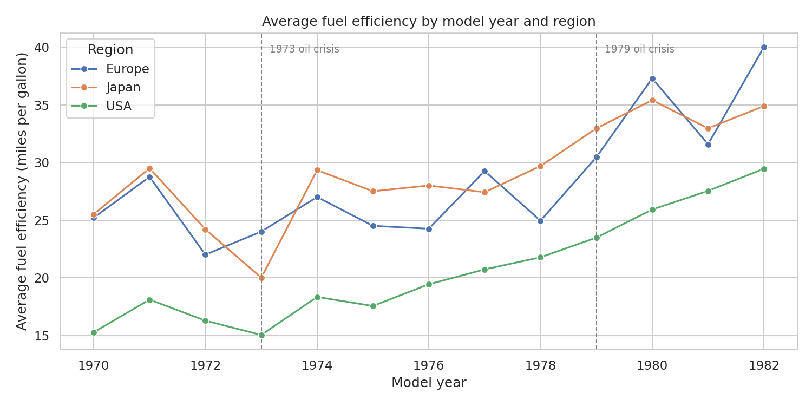
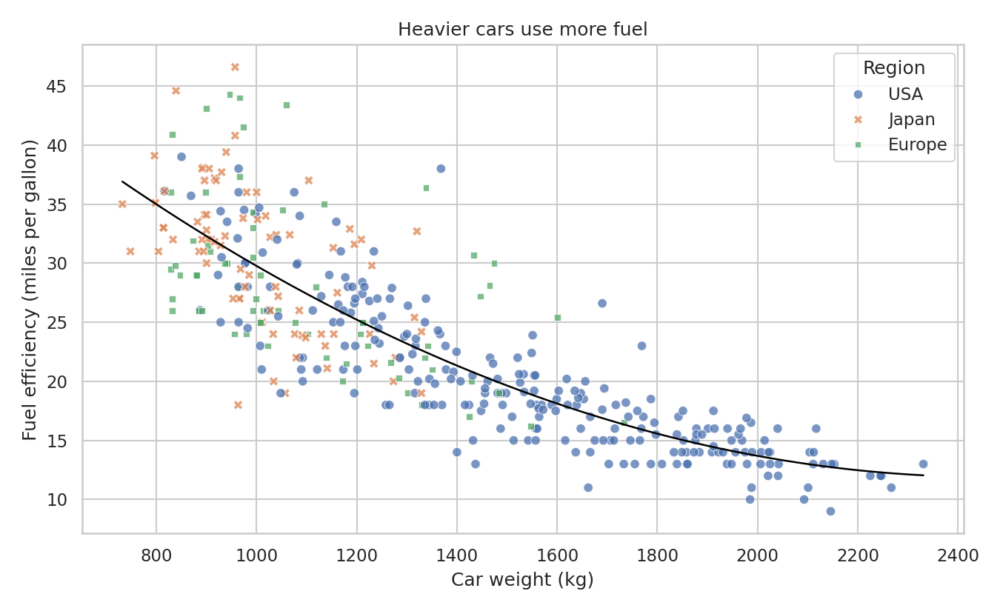
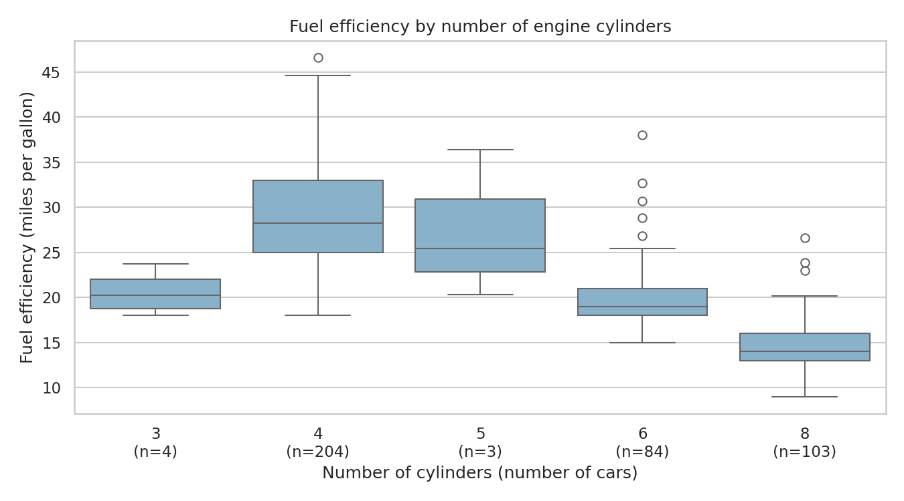

# Car Fuel Efficiency Analysis (1970–1982)

[](https://colab.research.google.com/github/lcrjl/car-fuel-efficiency-analysis/blob/main/notebooks/analysis.ipynb)

**Course:** 2323 CIS — Introduction to Data Science · King Khalid University
**Lab:** 14–15 — Lab Project Development, GitHub Publishing and Presentation

**Team Members:** 
Lama ali
448815941
maryam abdu 
448816153
faten masoud 
448815696
Taif Ali Mohammed 
448815887

## 1. Objective

**Data question:** How did car fuel efficiency change between 1970 and 1982, and which car characteristics (weight, cylinders, horsepower, region of origin) are most strongly linked to it?

## 2. Data source

| Item | Details |
| --- | --- |
| Dataset | Auto MPG (398 cars, model years 1970–1982) |
| Original source | UCI Machine Learning Repository — https://archive.ics.uci.edu/dataset/9/auto+mpg |
| Copy used | seaborn-data — https://github.com/mwaskom/seaborn-data/blob/master/mpg.csv |
| How it is loaded | `seaborn.load_dataset("mpg")` inside the notebook (no manual entry) |
| Licence / access | Public dataset, no confidential or personal data |

More detail: [`data/README.md`](data/README.md).

## 3. Repository structure

```
car-fuel-efficiency-analysis/
├── README.md                 ← this file
├── .gitignore
├── notebooks/
│   └── analysis.ipynb        ← full analysis, runs top to bottom
├── data/
│   └── README.md             ← data source and column notes
└── outputs/
    ├── mpg_clean.csv         ← final analysis-ready dataset (created by the notebook)
    └── figures/              ← charts saved by the notebook
```

## 4. How to run

1. Open `notebooks/analysis.ipynb` in Google Colab (File → Open notebook → GitHub tab → paste this repo link).
2. Click **Runtime → Run all**.
3. The notebook downloads the data, cleans it, draws the charts and saves results to `outputs/`.

Requirements: Python 3, pandas, numpy, seaborn, matplotlib (all pre-installed in Colab).

## 5. Steps

1. **Data understanding:** shape, columns, data types, missing values, descriptive statistics, and a diagnosis of data-quality problems.
2. **Data preparation:**
   - *Cleaning:* missing `horsepower` values filled with the median of cars with the same number of cylinders.
   - *Regular-expression extraction:* brand and model pulled out of the `name` text; misspelled brands fixed (e.g. `chevroelt` → `chevrolet`, `vw` → `volkswagen`).
   - *Transformation:* metric units added (L/100 km, kg, litres), full year, weight classes.
   - *Aggregation + reshaping (time series):* average mpg per year and region, pivoted into a year × region table.
3. **Visualizations:** (saved in `outputs/figures/`)
   1. Average mpg per year by region, with the 1973 and 1979 oil crises marked.
   2. Car weight vs mpg, coloured by region, with a correlation table.
   3. mpg by number of cylinders (box plot).
4. **Final dataset:** `outputs/mpg_clean.csv` (398 rows, 12 columns, no missing values) and `outputs/yearly_mpg_by_region.csv`.

## 6. Results

1. **Efficiency rose sharply from 1970 to 1982.** American cars show the clearest trend: after the 1973 oil crisis their average climbed almost every year, roughly doubling from about 15 to about 29.5 mpg.
2. **Japanese and European cars were more efficient than American cars in every year.**
3. **Weight is the characteristic most strongly linked to efficiency.** Heavier cars, with bigger engines and more cylinders, use more fuel.
4. **The regional gap is largely a weight gap.** Almost all Japanese and European cars were under about 1,400 kg, while many American cars weighed 1,500–2,300 kg.
5. **Cylinders:** median efficiency is about 28 mpg for 4 cylinders, 19 for 6 and 14 for 8.

Exact figures are printed in the notebook under each chart.





## 7. Limitations

- **Old, narrow data:** 398 car models sold in the USA, 1970–1982. Results may not apply to modern cars or the Saudi market.
- **Models, not sales:** each model counts once regardless of how many were sold.
- **Small groups:** some years have only a few European or Japanese cars, and only 4 three-cylinder and 3 five-cylinder cars exist, so those averages are unstable.
- **Imputed values:** a few missing horsepower values were filled with group medians.
- **Correlation, not causation:** weight, engine size and cylinders rise together, so their separate effects cannot be isolated here.

## 8. Team contribution

| Member | Contribution |
| --- | --- |
| Name 1 | _to be completed_ |
| Name 2 | _to be completed_ |
| Name 3 | _to be completed_ |
| Name 4 | _to be completed_ |
